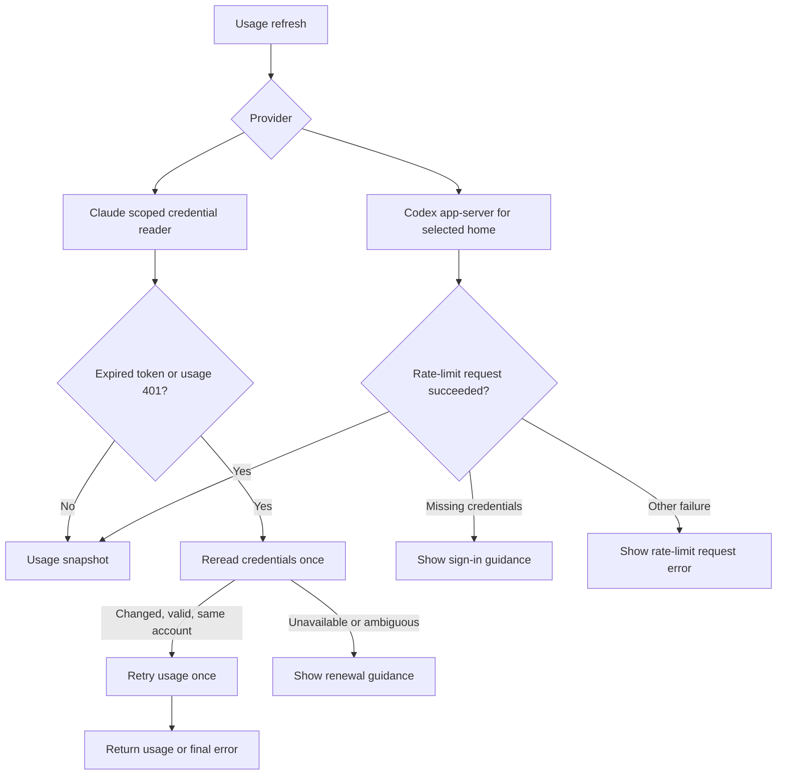

# Credential recovery

Toki reads Claude credentials and delegates Codex authentication to its app-server.
An expired access token does not necessarily mean the account needs a new login.
Recovery must stay within the selected account and must not replay reset redemption.

## High-level design

Discovery checks do not force renewal. Account configuration remains intact when
authentication fails. Network failures and usage limits are not evidence of expiry.

## Automatic Claude renewal investigation

The [CLI reference](https://code.claude.com/docs/en/cli-reference) documents
`claude auth login`, `logout`, and `status`. It does not document a dedicated
non-interactive refresh operation; status reporting alone is not a renewal guarantee.
The [authentication guide](https://code.claude.com/docs/en/authentication) directs
users to `/login` when their login expires and cannot be refreshed.

Toki therefore rereads credentials renewed by Claude Code and otherwise gives
renewal guidance. It does not issue a model request to trigger refresh or write
Claude tokens. Automatic renewal needs a supported interface with verified
rotation, concurrent-writer, persistence, and config-directory semantics. Inactive
claude-swap credentials also need an account-scoped renewal mechanism; switching
alone is not proof of renewal. Those guarantees remain unverified.

## Codex restrictions investigation

The [app-server documentation](https://developers.openai.com/codex/app-server/)
defines managed authentication and explicit renewal through `account/read` with
`refreshToken: true`. Codex remains responsible for token storage.

The [app-server account processor](https://github.com/openai/codex/blob/main/codex-rs/app-server/src/request_processors/account_processor.rs)
returns `-32600` with `codex account authentication required to read rate limits`;
this identifies missing authentication, not an expired token. Toki surfaces that condition
as sign-in guidance rather than attempting an unproven refresh. Other rate-limit
failures retain their own RPC error instead of an unrelated usage request error.

OpenAI documents that a [device restriction](https://help.openai.com/en/articles/20001559-understanding-card-and-device-limits-in-chatgpt)
can sign out a previously working paid account after a later check. It does not
document a corresponding Codex RPC error shape. A generic 401/403 or multiple local
accounts cannot establish that diagnosis. Usage resets and credit purchases do not
remove device restrictions. Toki must not guess restriction codes or repeatedly
renew a login rejected for a confirmed restriction.

The original account incident has not been reproduced. Validation uses synthetic
credentials and subprocess responses; live rotation requires a disposable test
account. Native UI behavior needs a separate manual check.
